# Automated AWS Cost Optimizer

## 1. Project Title and Objective

### Automated AWS Cost Optimizer

The **Automated AWS Cost Optimizer** is a serverless AWS automation project designed to identify selected EC2 instances that may be unnecessarily running and reduce AWS costs safely.

The system uses predefined **tags, environment rules, instance state, and schedules** to determine which EC2 instances can be managed.

Development EC2 instances are automatically:

* **Started during working hours**
* **Stopped outside working hours**

The system is designed with safety controls to ensure that production instances and unmanaged resources are not affected.

---

## 2. AWS Services Used

* **AWS Lambda** – Executes the EC2 cost-optimization logic.
* **Amazon EC2** – Provides the development instances that are managed.
* **Amazon EventBridge Scheduler** – Automatically triggers Lambda at scheduled times.
* **Amazon CloudWatch** – Provides logs, metrics, dashboard monitoring, and error alarms.
* **AWS IAM** – Provides secure, least-privilege permissions for Lambda and EventBridge Scheduler.

---

## 3. Architecture / Workflow

### Architecture

```text
                  Amazon EventBridge Scheduler
                              |
               +--------------+--------------+
               |                             |
        09:00 AM IST                    07:00 PM IST
        Start Schedule                  Stop Schedule
               |                             |
               |                             |
        {"action":"start"}             {"action":"stop"}
               |                             |
               +--------------+--------------+
                              |
                              v
                    AWS Lambda Function
                  automated-cost-optimizer
                              |
                              v
                    Describe EC2 Instances
                              |
                              v
                     Check Safety Rules
                              |
              +---------------+---------------+
              |                               |
          Eligible                        Not Eligible
              |                               |
              v                               v
       Start / Stop EC2                    SKIP
              |
              v
        Amazon EC2
              |
              v
       CloudWatch Logs
              |
       +------+------+
       |             |
    Metrics        Alarm
       |
       v
 CloudWatch Dashboard
```

### Workflow

1. EventBridge Scheduler triggers the Lambda function.
2. The Lambda function retrieves EC2 instances using `DescribeInstances`.
3. Each instance is evaluated using predefined tags and conditions.
4. Only eligible development instances are selected.
5. Production instances are explicitly protected.
6. At **09:00 AM IST**, eligible stopped development instances are started.
7. At **07:00 PM IST**, eligible running development instances are stopped.
8. CloudWatch records Lambda execution logs and metrics.
9. A CloudWatch alarm monitors Lambda execution errors.
10. A CloudWatch dashboard provides visibility into Lambda activity.

---

## 4. Implementation Steps

### Step 1 – Create and Tag an EC2 Instance

A test EC2 instance was created for the cost optimizer.

The following tags were used:

| Tag                 | Value                |
| ------------------- | -------------------- |
| `Name`              | `CostOptimizer-Test` |
| `Environment`       | `dev`                |
| `AutoCostOptimizer` | `true`               |
| `Schedule`          | `business-hours`     |

These tags allow the Lambda function to determine whether the instance can be managed.

---

### Step 2 – Create IAM Role

An IAM role named:

```text
CostOptimizerLambdaRole
```

was created for the Lambda function.

The role includes:

```text
AWSLambdaBasicExecutionRole
```

for CloudWatch logging.

An inline EC2 policy provides only the required permissions:

```text
ec2:DescribeInstances
ec2:DescribeTags
ec2:StartInstances
ec2:StopInstances
```

The project intentionally does **not** grant:

```text
ec2:TerminateInstances
AdministratorAccess
AmazonEC2FullAccess
```

This follows the principle of least privilege.

---

### Step 3 – Create Lambda Function

Lambda function:

```text
automated-cost-optimizer
```

Runtime:

```text
Python 3.14
```

The Lambda function:

* Discovers EC2 instances.
* Reads EC2 tags.
* Checks the instance state.
* Identifies eligible development instances.
* Starts or stops eligible instances.
* Skips production and unmanaged instances.
* Records execution information in CloudWatch.
* Supports dry-run testing.

---

### Step 4 – Implement EC2 Safety Rules

An EC2 instance is eligible for automation only when all required conditions are satisfied:

```text
AutoCostOptimizer = true
Environment = dev
Schedule = business-hours
```

The Lambda also checks the current EC2 state.

For example:

```text
STOP → Only running instances
START → Only stopped instances
```

Production instances are explicitly protected:

```text
Environment = prod
        ↓
      SKIP
```

This prevents the system from blindly modifying production resources.

---

### Step 5 – Implement Start and Stop Actions

The Lambda accepts an action through the event payload.

#### Start

```json
{
  "action": "start"
}
```

The Lambda starts eligible stopped development instances.

#### Stop

```json
{
  "action": "stop"
}
```

The Lambda stops eligible running development instances.

---

### Step 6 – Implement Dry-Run Mode

The Lambda supports safe testing through dry-run mode.

Example:

```json
{
  "action": "stop",
  "dry_run": true
}
```

When dry-run mode is enabled, the Lambda identifies eligible instances but does not actually start or stop them.

Example output:

```text
Result : ELIGIBLE
Action : WOULD STOP INSTANCE
```

This provides an additional safety mechanism before performing real EC2 actions.

---

### Step 7 – Configure EventBridge Scheduler

Two EventBridge Scheduler schedules were configured.

#### Start Schedule

```text
Name:
cost-optimizer-start

Time:
09:00 AM IST

Cron:
0 9 * * ? *

Payload:
{
  "action": "start",
  "dry_run": false
}
```

This automatically starts eligible development instances at the beginning of working hours.

#### Stop Schedule

```text
Name:
cost-optimizer-stop

Time:
07:00 PM IST

Cron:
0 19 * * ? *

Payload:
{
  "action": "stop",
  "dry_run": false
}
```

This automatically stops eligible development instances outside working hours.

Timezone:

```text
Asia/Calcutta
UTC+05:30
```

Flexible time window:

```text
Off
```

Both schedules are enabled.

---

### Step 8 – Configure CloudWatch Monitoring

CloudWatch Logs are used to monitor Lambda executions.

Log group:

```text
/aws/lambda/automated-cost-optimizer
```

The Lambda records:

* Instance ID
* Instance name
* Current state
* Environment
* Optimization tag
* Schedule
* Requested action
* Affected instances
* Skipped instances
* Errors

---

### Step 9 – Create CloudWatch Dashboard

A dashboard named:

```text
CostOptimizerDashboard
```

was created.

The dashboard monitors:

### Invocations

Shows how frequently the Lambda function executes.

### Errors

Shows whether Lambda executions are failing.

### Duration

Shows Lambda execution time.

---

### Step 10 – Create CloudWatch Alarm

A CloudWatch alarm was configured for Lambda errors.

Alarm:

```text
CostOptimizer-Lambda-Errors
```

Configuration:

```text
Metric:
Lambda Errors

Statistic:
Sum

Period:
5 minutes

Threshold:
>= 1
```

The alarm enters the **In Alarm** state when the Lambda encounters an execution error.

---

### Step 11 – Execution Reporting

The Lambda provides execution information including:

```text
evaluatedInstances
affectedInstances
skippedInstances
```

Example:

```json
{
  "statusCode": 200,
  "action": "stop",
  "dryRun": false,
  "evaluatedInstances": [],
  "affectedInstances": [],
  "skippedInstances": []
}
```

This provides an audit trail of what the optimizer evaluated and what action was performed.

---

### Step 12 – Testing

The system was tested with both actions:

```json
{
  "action": "stop",
  "dry_run": false
}
```

and:

```json
{
  "action": "start",
  "dry_run": false
}
```

The test EC2 instance successfully changed between:

```text
Running → Stopped
```

and:

```text
Stopped → Running
```

Dry-run testing was also performed:

```json
{
  "action": "stop",
  "dry_run": true
}
```

The Lambda reported:

```text
WOULD STOP INSTANCE
```

without actually stopping the instance.

---

## 5. Screenshots of Important Configurations and Results

### Screenshot 1: EC2 Instance Tags
The test instance is tagged so the optimizer can identify it.

| Key | Value |
|-----|-------|
| Name | CostOptimizer-Test |
| Environment | dev |
| AutoCostOptimizer | true |
| Schedule | business-hours |

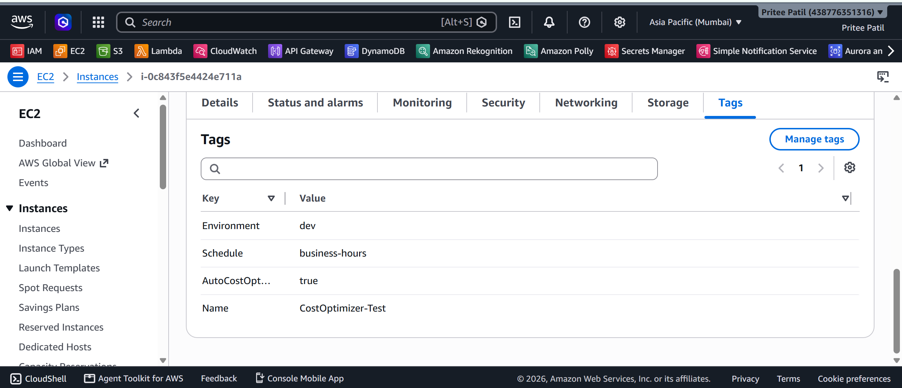

---

### Screenshot 2: IAM Lambda Role
Role `CostOptimizerLambdaRole` with the managed policy `AWSLambdaBasicExecutionRole` attached, which allows writing logs to CloudWatch.

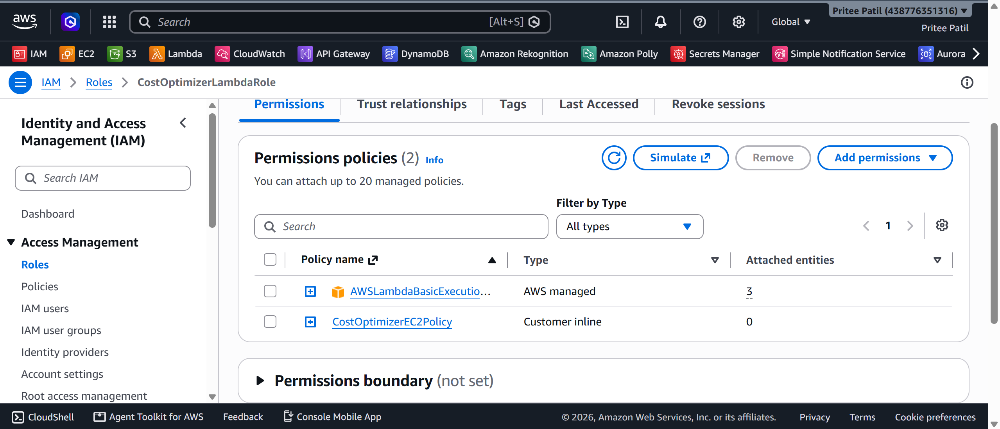

---

### Screenshot 3: IAM EC2 Permissions
Inline policy granting only the EC2 actions the function needs:

- `ec2:DescribeInstances`
- `ec2:DescribeTags`
- `ec2:StartInstances`
- `ec2:StopInstances`

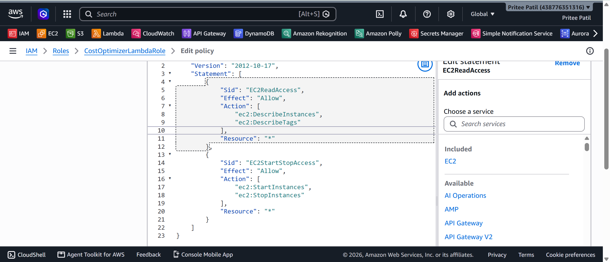

---

### Screenshot 4: Lambda Function
Function `automated-cost-optimizer` running on Python 3.14.

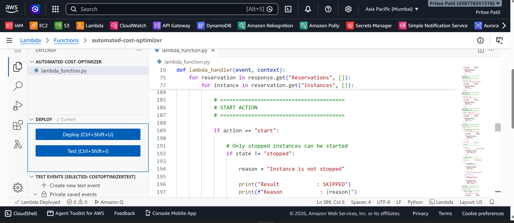

---

### Screenshot 5: Lambda Successful Stop Test
Test event with `action = stop` and `dryRun = false`, returning `statusCode = 200`.

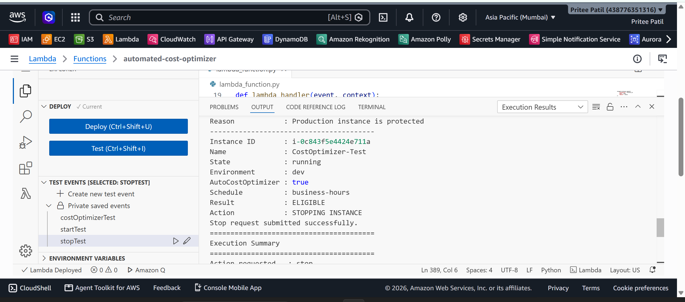

---

### Screenshot 6: Lambda Successful Start Test
Successful execution of the `start` action.

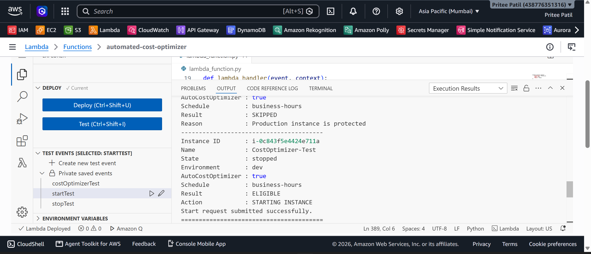

---

### Screenshot 7: Dry-Run Test
With `dryRun = true`, the function logs `WOULD STOP INSTANCE` and makes no changes to the instance.


---

### Screenshot 8: EventBridge Start Schedule
Rule `cost-optimizer-start`, set to run at **09:00 AM IST**, status **Enabled**.

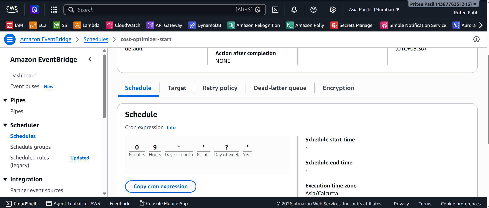

---

### Screenshot 9: EventBridge Stop Schedule
Rule `cost-optimizer-stop`, set to run at **07:00 PM IST**, status **Enabled**.

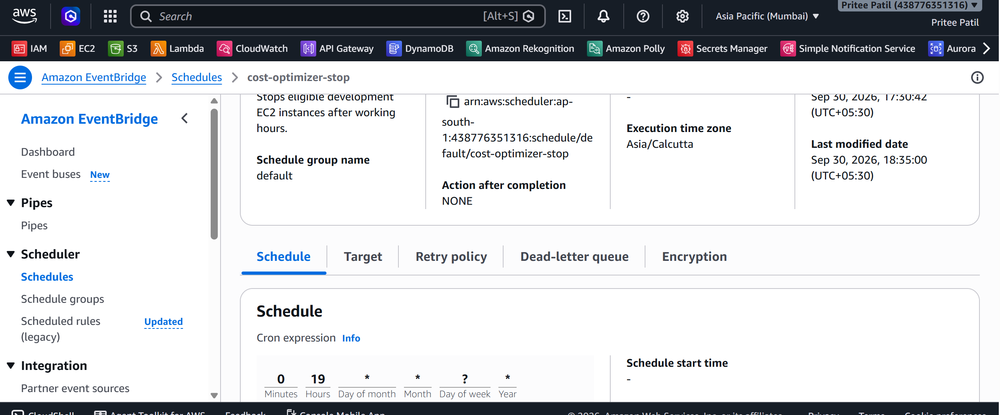

---

### Screenshot 10: CloudWatch Logs
Lambda execution logs showing the requested action, instance details, `ELIGIBLE` / `SKIPPED` decisions, and the execution summary.

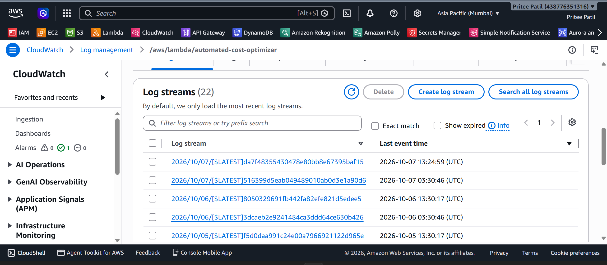

---

### Screenshot 11: CloudWatch Dashboard
Dashboard `CostOptimizerDashboard` with widgets for:

- Invocations
- Errors
- Duration

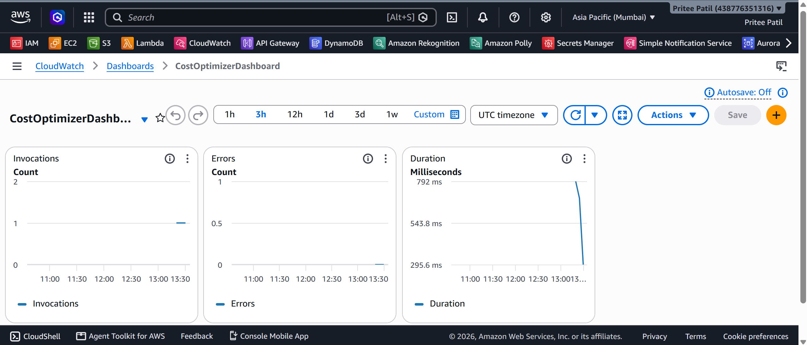

---

### Screenshot 12: CloudWatch Alarm
Alarm `CostOptimizer-Lambda-Errors`, which notifies when the function reports errors.

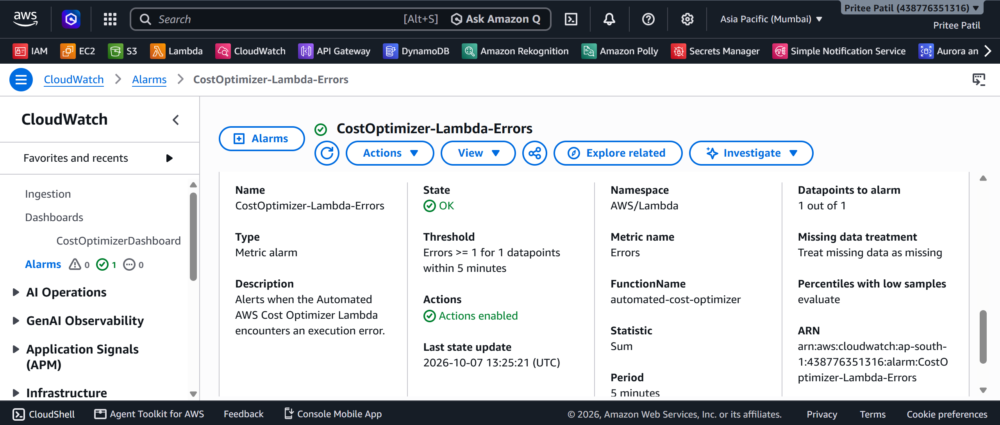
---

## 6. How to Run or Deploy the Project

### Prerequisites

You need:

* An AWS account
* AWS Management Console access
* Permission to create Lambda, IAM, EC2, EventBridge Scheduler, and CloudWatch resources
* An EC2 development/test instance
* Appropriate AWS IAM permissions

---

### Step 1 – Configure EC2 Tags

Tag the development instance:

```text
Environment = dev
AutoCostOptimizer = true
Schedule = business-hours
```

---

### Step 2 – Create IAM Role

Create:

```text
CostOptimizerLambdaRole
```

Attach:

```text
AWSLambdaBasicExecutionRole
```

Add the required EC2 permissions:

```text
ec2:DescribeInstances
ec2:DescribeTags
ec2:StartInstances
ec2:StopInstances
```

---

### Step 3 – Deploy Lambda

Create:

```text
automated-cost-optimizer
```

Runtime:

```text
Python 3.14
```

Paste the Lambda source code into the Lambda Code editor and deploy it.

---

### Step 4 – Test Lambda

Test STOP:

```json
{
  "action": "stop",
  "dry_run": false
}
```

Test START:

```json
{
  "action": "start",
  "dry_run": false
}
```

Test dry-run:

```json
{
  "action": "stop",
  "dry_run": true
}
```

---

### Step 5 – Configure EventBridge Scheduler

Create the two schedules:

```text
cost-optimizer-start
cost-optimizer-stop
```

Use:

```text
09:00 AM IST → start
07:00 PM IST → stop
```

---

### Step 6 – Configure CloudWatch

Verify:

```text
/aws/lambda/automated-cost-optimizer
```

Create:

```text
CostOptimizerDashboard
```

and:

```text
CostOptimizer-Lambda-Errors
```

---

### Step 7 – Verify Automation

The final system automatically performs:

```text
09:00 AM IST
      ↓
Start eligible development instances


07:00 PM IST
      ↓
Stop eligible development instances
```

Production and unmanaged instances are skipped.

---

## 7. Key Learnings

Through this project, the following AWS concepts were implemented and understood:

* Serverless automation using AWS Lambda
* EC2 instance lifecycle management
* AWS IAM roles and least-privilege permissions
* EC2 tag-based resource selection
* EventBridge Scheduler for automated tasks
* CloudWatch Logs and metrics
* CloudWatch dashboards
* CloudWatch alarms
* Safe automation using predefined conditions
* Dry-run functionality
* Production resource protection
* Start/stop automation based on working hours
* Monitoring and execution reporting
* Designing cost-optimization workflows without blindly terminating resources

---

## Project Safety Principles

This project follows several safety principles:

1. **No blind resource termination**
2. **Production instances are protected**
3. **Only tagged resources are considered**
4. **Only development instances are managed**
5. **EC2 state is checked before performing an action**
6. **Dry-run mode is available for testing**
7. **Least-privilege IAM permissions are used**
8. **CloudWatch monitoring is enabled**
9. **Lambda errors are monitored through an alarm**

The optimizer uses:

```text
Tags + Conditions + Schedule
```

rather than blindly modifying AWS resources.

---

## Conclusion

The **Automated AWS Cost Optimizer** demonstrates how AWS serverless services can be combined to create a safe and automated cost-management solution.

By automatically stopping development instances outside working hours and starting them during working hours, the system helps reduce unnecessary EC2 runtime while protecting production resources through explicit rules and least-privilege IAM controls.
